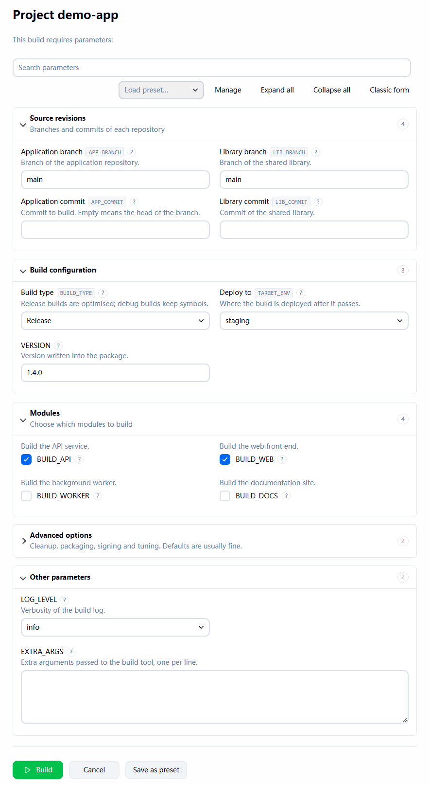
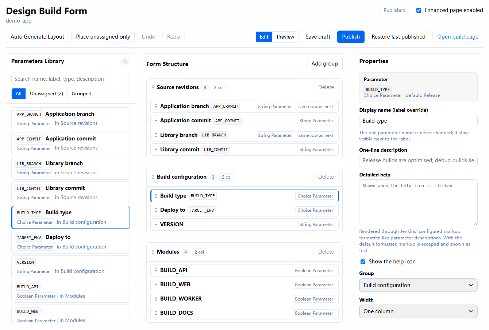
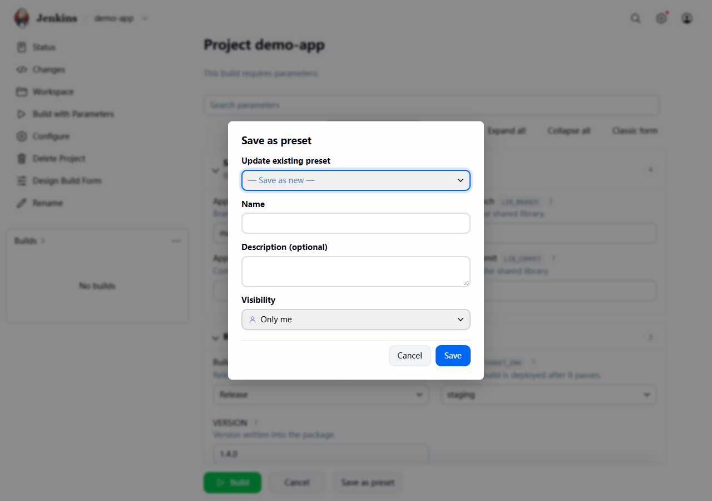

# Build Parameter Enhancer

[](https://github.com/Liam-Frost/Jenkins-Build-Parameter-Enhancer-Plugin/actions/workflows/build.yml)
[](https://plugins.jenkins.io/build-parameter-enhancer)
[](LICENSE)

English · [简体中文](README.zh-CN.md)

Turns a long **Build with Parameters** page into grouped, searchable sections, and lets users save the values
they build with as presets. Parameter definitions, names and the submitted values are not changed, so jobs and
Jenkinsfiles keep working exactly as before.

<p align="center">
  
</p>

## Features

- **Groups**: collapsible sections with a title, a description and one or two columns. A group can hold
  sub-groups, placed anywhere between its parameters.
- **Labels and help**: a readable label per parameter (the real name stays visible), a one-line summary, and
  longer help text behind a `?` button. The original Jenkins description is kept.
- **Search**: filters parameters by name, label, description or help text. Press `/` to focus it.
- **Presets**: users save the current values under a name and load them later. Personal presets are visible
  only to their owner; users who can configure the job can also share presets with everyone. Applying a preset
  can be undone with **Restore**. Password parameters are never stored in a preset.
- **Designer**: a drag-and-drop editor on each job, with drafts, publish, undo/redo, a live preview, and the last
  ten published layouts kept for rollback.
- **Auto layout**: builds a first layout from parameter names and types, using rules an administrator can edit.
- **Classic form switch**: each user can switch back to the native Jenkins page; the choice is remembered in the
  browser.

<p align="center">
  
</p>

## Compatibility

The plugin depends on Jenkins core only. The interface is in English and Simplified Chinese, following the
language Jenkins shows the page in.

## Getting started

1. Open a job that has parameters and choose **Design Build Form** in its side panel. This needs the
   *Job/Configure* permission.
2. Click **Auto Generate Layout** to start from the default rules, or **Add group** to start empty.
3. Drag parameters and groups into place. Select a group or parameter to edit its label, help text, columns
   and width in the **Properties** panel.
4. Use **Preview** to check the page, then **Publish**. Users see the new page on their next visit to
   **Build with Parameters**.

**Save draft** keeps unfinished work without showing it to users, and **Discard draft** throws it away.
**Restore last published** goes back to the layout published before the current one; the last ten are kept.

## Presets

On the build page, fill in the values and click **Save as preset** next to **Build**. Pick a preset from
**Load preset…** in the toolbar to apply it, and **Restore** to go back to the values you had before. **Manage**
lists the presets you can edit, to rename or delete them.

| Preset | Who can see it | Who can create or change it |
| --- | --- | --- |
| Personal | Its owner | Any signed-in user with *Job/Build* |
| Shared | Everyone with *Job/Read* | Users with *Job/Configure* |

<p align="center">
  
</p>

A preset only contains values for parameters the job still defines. When a value can no longer be applied
(for example a choice that was removed), the page says which parameters were skipped.

## How it works

Jenkins renders its normal Build with Parameters page. The plugin adds a script to that page which moves the
existing parameter controls into the published layout. Controls are moved, never re-created, so their values,
event handlers and the scripts of other plugins keep working, and the form submits exactly the same data as the
native page. If anything goes wrong while the page is being rearranged, the change is rolled back and the native
page is shown.

The layout is stored in `build-parameter-enhancer.xml` in the job's directory, not in `config.xml`. A Pipeline that
redefines its parameters with `properties([...])` therefore cannot erase it, and the layout is copied when the job
is copied. Parameters added to the job later appear in a fallback group until they are placed.

Shared presets are stored in the same file. Personal presets are stored on the user, per job.

### Supported parameter types

String, multi-line string, boolean, choice, password, and
[Git Parameter](https://plugins.jenkins.io/git-parameter/) controls get full styling. Parameters of any other
type keep their native control and still submit correctly; they can be grouped, labelled and given help text.

## Configuration

**Manage Jenkins → System → Build Parameter Enhancer** turns the plugin off for every job and holds the
Auto Generate Layout rules as JSON.

To turn the plugin off without changing configuration, for example while investigating a problem, start Jenkins
with:

```
-Dio.jenkins.plugins.bpe.BuildParameterEnhancerConfiguration.disabled=true
```

A single page can also be opened without the enhancement by adding `?bpe=classic` to its URL.

## Security

- The data sent to the build page holds display information only, never parameter default values.
- Password parameters keep their native control and are excluded from presets on the server.
- Every API call checks the job permission listed above, and every write requires a POST with a CSRF crumb.

Report security issues to the [Jenkins security team](https://www.jenkins.io/security/reporting/), not in a
public issue.

## Contributing

See [CONTRIBUTING.md](CONTRIBUTING.md) for how to build, test and run the plugin locally.

## Changelog

See [GitHub releases](https://github.com/Liam-Frost/Jenkins-Build-Parameter-Enhancer-Plugin/releases). A tag such as `v1.0.0` also attaches the packaged `.hpi` to its release,
so the plugin can be installed before it is available in the update center.

## License

[MIT](LICENSE)
