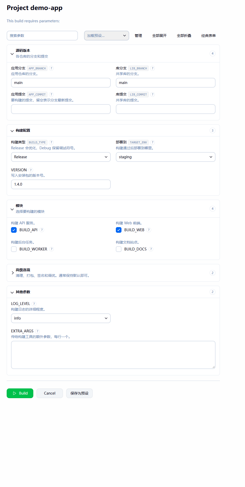
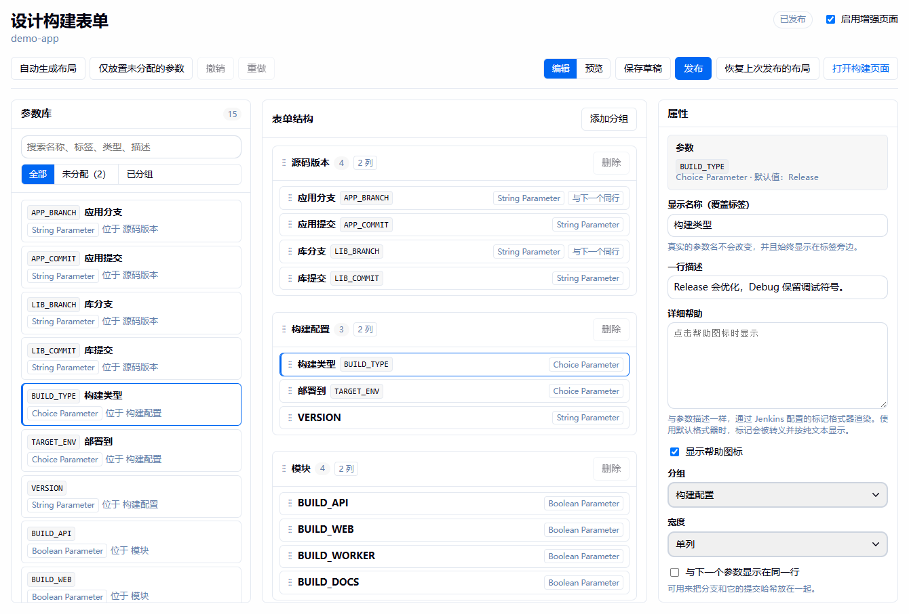
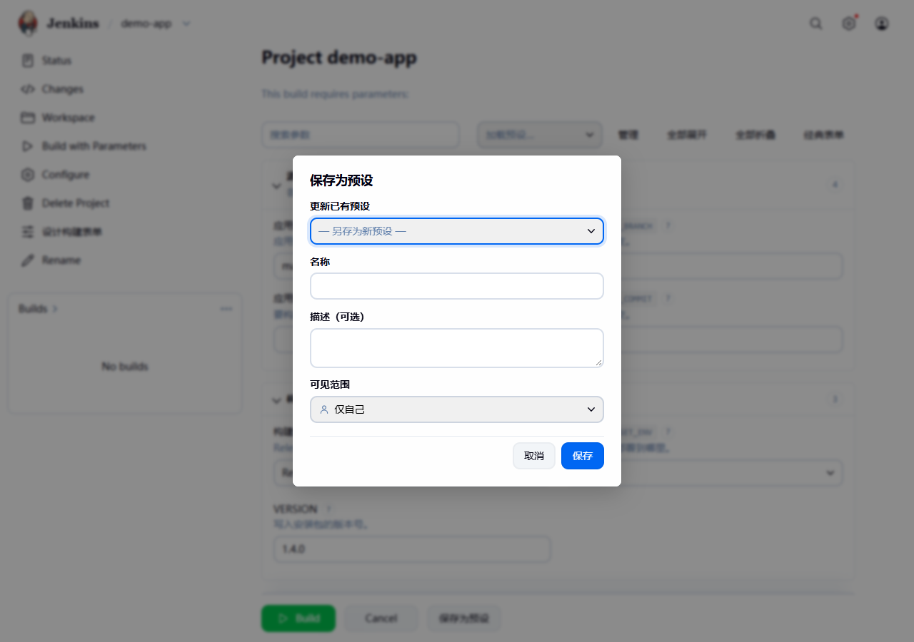

# Build Parameter Enhancer

[](https://github.com/Liam-Frost/Jenkins-Build-Parameter-Enhancer-Plugin/actions/workflows/build.yml)
[](https://plugins.jenkins.io/build-parameter-enhancer)
[](https://www.jenkins.io/)
[](https://adoptium.net/)
[](LICENSE)

[English](README.md) · 简体中文

把冗长的**参数化构建**页面整理成可折叠、可搜索的分组，并让用户把常用的参数值保存为预设。参数定义、参数名和提交的值都不会改变，现有任务和 Jenkinsfile 照常工作。

<p align="center">
  
</p>

## 功能

- **分组**：可折叠的区块，带标题、描述，支持单列或双列。分组里可以再放子分组，位置可以放在参数之间任意处。
- **标签和帮助**：为每个参数设置易读的标签（真实参数名始终可见）、一行摘要，以及点击 `?` 才显示的详细帮助。Jenkins 原有的描述会保留。
- **搜索**：按参数名、标签、描述或帮助文字筛选。按 `/` 聚焦搜索框。
- **预设**：用户把当前的值以一个名字保存，之后一键加载。个人预设只有自己可见；拥有任务配置权限的用户还可以创建所有人可见的共享预设。应用预设后可以用**还原**撤销。密码参数永远不会保存到预设中。
- **设计器**：每个任务都有一个拖放编辑器，支持草稿、发布、撤销/重做、实时预览，并保留最近十个已发布的布局用于回滚。
- **自动布局**：根据参数名和类型生成初始布局，规则可由管理员修改。
- **经典表单开关**：每个用户都可以切换回 Jenkins 原生页面，选择会记在浏览器中。

<p align="center">
  
</p>

## 环境要求

- Jenkins 2.555.3 或更高版本
- Controller 上运行 Java 21 或更高版本

插件只依赖 Jenkins 核心。界面支持英文和简体中文，跟随 Jenkins 页面显示的语言。

## 快速上手

1. 打开一个带参数的任务，在侧边栏选择**设计构建表单**。需要*任务/配置*权限。
2. 点击**自动生成布局**按默认规则开始，或点击**添加分组**从空白开始。
3. 把参数和分组拖到合适的位置。选中分组或参数后，可以在**属性**面板中编辑标签、帮助文字、列数和宽度。
4. 用**预览**检查页面，然后**发布**。用户下次打开**参数化构建**页面时就会看到新布局。

**保存草稿**可以保存未完成的修改而不对用户显示，**丢弃草稿**则放弃这些修改。**恢复上次发布的布局**会回到当前布局之前发布的那一版，最多保留十个。

## 预设

在构建页面填好参数值后，点击**构建**旁边的**保存为预设**。在工具栏的**加载预设…**中选择一个预设即可应用，点击**还原**可以回到应用之前的值。**管理**会列出你能编辑的预设，可以重命名或删除。

| 预设 | 谁能看到 | 谁能创建或修改 |
| --- | --- | --- |
| 个人 | 预设的所有者 | 任何拥有*任务/构建*权限的已登录用户 |
| 共享 | 所有拥有*任务/读取*权限的用户 | 拥有*任务/配置*权限的用户 |

<p align="center">
  
</p>

预设只包含任务当前仍定义的参数的值。某个值无法再应用时（例如某个选项已被删除），页面会提示哪些参数被跳过。

## 定时构建使用预设

在任务配置里添加**使用预设定时构建**触发器，可以让定时任务使用某个共享预设的参数值运行构建。

```
H 2 * * *    % Preset=Nightly
H 12 * * 1-5 % Preset=Daily smoke; BRANCH=develop
```

每行一条日程：标准的 Jenkins cron 表达式，接 `%` 分隔符，再接 `Preset=<名字>`。
可选的 `KEY=value` 覆盖值以 `;` 分隔，会优先于预设里的值。
以 `#` 开头的行是注释；`TZ=` 行设置其后各行的时区。

| 组成部分 | 含义 |
| --- | --- |
| `H 2 * * *` | 标准 Jenkins cron，`H` 可分散负载。 |
| `Preset=Nightly` | 共享预设的精确名字（需要*任务/配置*权限）。 |
| `BRANCH=develop` | 可选覆盖值，优先于预设中对应参数的值。 |

**Pipeline 写法：**
```groovy
triggers { presetCron('H 2 * * * % Preset=Nightly') }
```

如果预设找不到，或某个参数值无效（例如某个选项已被删除），构建会被跳过，错误会显示在
任务主页的**预设日程**块中。密码参数不能在日程里覆盖（该值会以明文存入 `config.xml`）。

复制任务时，所有日程行会自动被注释掉，去掉 `#` 即可重新启用。

## 工作原理

Jenkins 照常渲染它的参数化构建页面，插件向该页面加入一段脚本，把已有的参数控件移动到已发布的布局中。控件只会被移动，不会被重新创建，所以它们的值、事件处理以及其他插件的脚本都照常工作，表单提交的数据也与原生页面完全相同。如果整理页面的过程中出现任何问题，改动会被撤回，显示原生页面。

布局保存在任务目录下的 `build-parameter-enhancer.xml` 中，而不是 `config.xml`。因此用 `properties([...])` 重新定义参数的 Pipeline 不会抹掉布局，复制任务时布局也会一起复制。之后新增的参数会先显示在后备分组中，直到被放进某个分组。

共享预设保存在同一个文件中，个人预设按任务保存在用户配置里。

### 支持的参数类型

字符串、多行字符串、布尔值、选项、密码以及 [Git Parameter](https://plugins.jenkins.io/git-parameter/) 控件会获得完整的样式。其他类型的参数保留原生控件，仍能正确提交，也可以分组、设置标签和帮助文字。

## 配置

**系统管理 → 系统配置 → Build Parameter Enhancer** 可以为所有任务关闭插件，并以 JSON 编辑自动生成布局的规则。

如果想在不修改配置的情况下关闭插件（例如排查问题时），可以用下面的参数启动 Jenkins：

```
-Dio.jenkins.plugins.bpe.BuildParameterEnhancerConfiguration.disabled=true
```

在页面 URL 后加上 `?bpe=classic`，可以让单个页面不经过增强直接打开。

## 安全

- 发送到构建页面的数据只包含显示信息，不包含参数默认值。
- 密码参数保留原生控件，并在服务端被排除在预设之外。
- 每个 API 调用都会检查上表中的任务权限，每次写操作都要求带 CSRF crumb 的 POST 请求。

请把安全问题报告给 [Jenkins 安全团队](https://www.jenkins.io/security/reporting/)，不要提交公开 issue。

## 参与贡献

构建、测试和本地运行插件的方法见 [CONTRIBUTING.md](CONTRIBUTING.md)。

## 更新日志

见 [GitHub Releases](https://github.com/Liam-Frost/Jenkins-Build-Parameter-Enhancer-Plugin/releases)。推送 `v1.0.0` 这样的标签时，打包好的 `.hpi` 会附在对应的 Release 上，插件进入更新中心之前也可以先下载安装。

## 许可证

[MIT](LICENSE)
